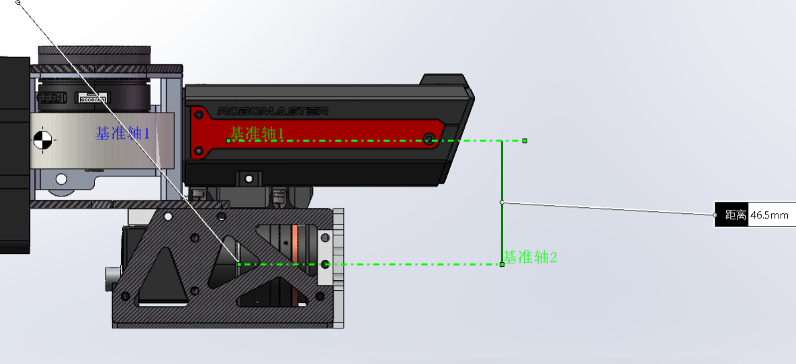
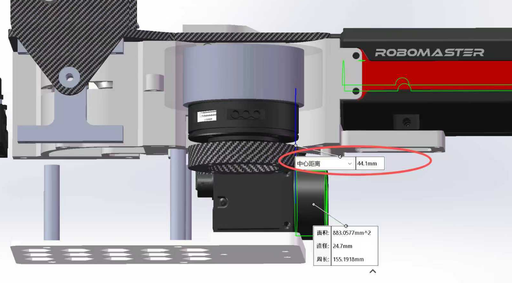
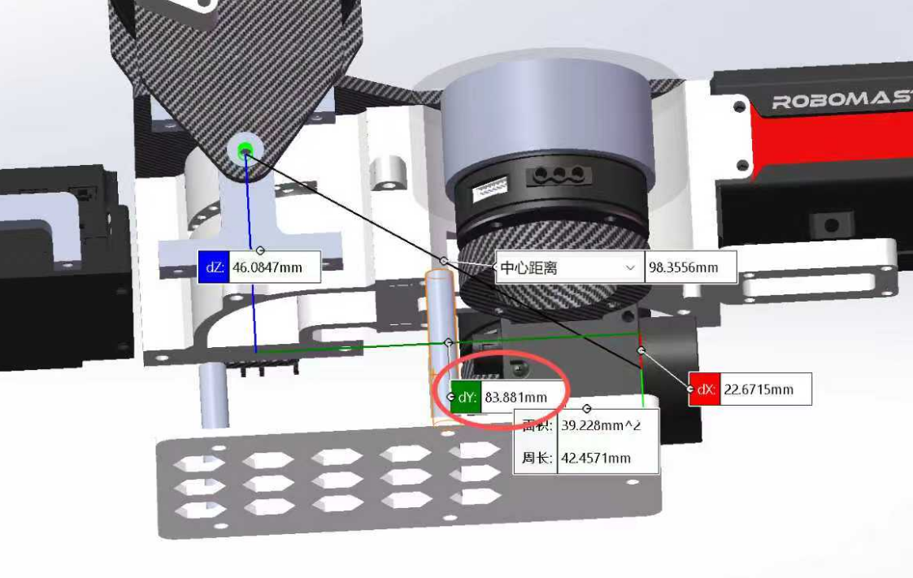

# 机械标定教程：从云台零点到相机外参
---

## 0. 调车前，机械先保证这些

在视觉开始调自瞄之前，机械需要先把“枪”本身调稳。否则视觉算得再准，弹着点也会把问题掩盖掉。

- 在期望击打距离下，弹道散布不超过小装甲板面积的 0.1（约 42×42 mm）。
- 子弹速度波动不超过 0.4 m/s；有测速模块时，两次测速误差不超过 0.4 m/s。
- 调车期间及时解决卡弹、弹道散布、干涉、刚性不足、掉螺丝、机械虚位。
- 相机、镜头、云台必须刚性连接；镜头不能松动，对焦环不能自己转。
- 线缆不能拉拽相机；3D 打印支架不能一推就变形。

---

## 1. 先定义两个零点
### 1.1 云台零点

本文约定：

> **云台零点 = pitch 轴与枪管中垂线的交点。**

拆开说：

- pitch 轴：pitch 关节的旋转轴，通常是一根穿过云台两侧轴承的横轴；
- 枪管中垂线：从枪管中心竖直向下的那条线；
- 两者的交点，就是云台零点。

在 CAD 里，先把 pitch 轴画出来，再把枪管中心线画出来，交点就是零点。实车上可以用铅垂线从枪管中心垂下来，再用记号笔在云台侧板/支架上标出 pitch 轴中心，找到交点后贴美纹纸标记。

为什么不用“yaw 轴和 pitch 轴的交点”？因为枪管通常不在 yaw 轴上，用枪管中垂线更符合“子弹从哪出”的直觉。关键是**机械、视觉、CAD 三处必须用同一个定义**。





> 上面两张图是 CAD 测量示例：基准轴 1/2、中心距离 46.5 mm、44.1 mm 等。数字只是示例，你们要以自己机器人最新图纸为准。

### 1.2 相机零点

本文按你们当前约定：

> **相机零点 = 传感器 CMOS 的中心。**


```text
相机零点约定：CMOS 中心 / 镜头光心（光圈处）
```

如果以后要改约定，前后方向重新量，不要只改一个符号。



> 图中 `dx / dy / dz` 和中心距离是 CAD 测量示例。重点是：测量起点是云台零点，终点是相机零点，方向按下一节的约定。


t_camera2gimbal：相机装在哪
它是一个向量：
t = [x, y, z]
- x：云台零点向前到相机零点；
- y：云台零点向左到相机零点；
- z：云台零点向上到相机零点。
它只描述“位置”，不描述“朝向”。

R_camera2gimbal：相机朝哪
它是一个旋转矩阵，描述相机坐标系相对云台坐标系的姿态。
- 相机 z 轴（光轴）指向云台的哪个方向；
- 相机 x/y 轴相对云台滚转了多少；
- 如果相机装歪了，这个矩阵就负责把“歪”描述出来。

R_gimbal2imubody：IMU 和云台怎么对齐
IMU 输出的四元数是“IMU body 相对世界”的姿态，但代码要的是“云台相对世界”的姿态。两者之间差一个安装旋转：
R_gimbal2world = R_gimbal2imubody^T * R_imubody2world * R_gimbal2imubody
它的每一列是云台的一个轴在 IMU body 里的方向。
- 如果 IMU 和云台完全同向：单位阵；
- 如果 IMU 绕 z 转了 180°：[-1,0,0; 0,-1,0; 0,0,1]；
- 如果 IMU 绕 z 转了 90°：[0,-1,0; 1,0,0; 0,0,1]。

## 3. 测 gimbal → camera 的 xyz

### 3.1 直接在图纸里量

1. 打开最新 CAD，找到云台零点（pitch 轴与枪管中垂线交点）；
2. 找到相机 CMOS 中心；
3. 量三个方向：
   - 前向：云台零点到 CMOS 中心，沿机器人前进方向的距离；
   - 右向：沿机器人右侧的距离；
   - 上向：沿机器人上方的距离；
4. 单位统一用 mm，交付时再换成 m；
5. 记录图纸版本号。

看图时注意：CAD 里可能有很多“基准轴”“中心距离”，不要量错起点。你们图里的 `基准轴1/基准轴2`、`中心距离` 就是为此存在的。

一个 CAD 示例：

```text
前向 x = 98.3556 mm
右向 y = 83.8810 mm
上向 z = 46.0847 mm
```

转成 DGE：

```text
t_camera2gimbal = [0.09836, -0.08388, 0.04608]   # 米，y 取反
```
